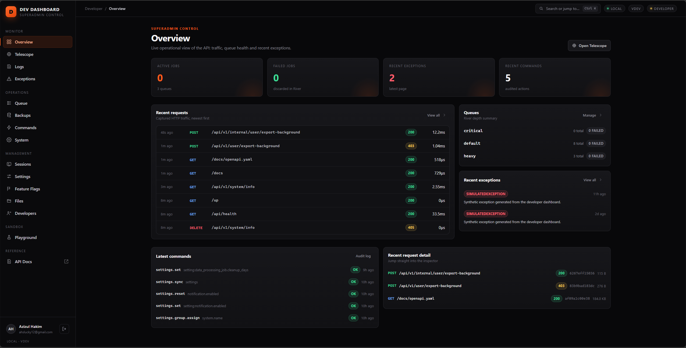
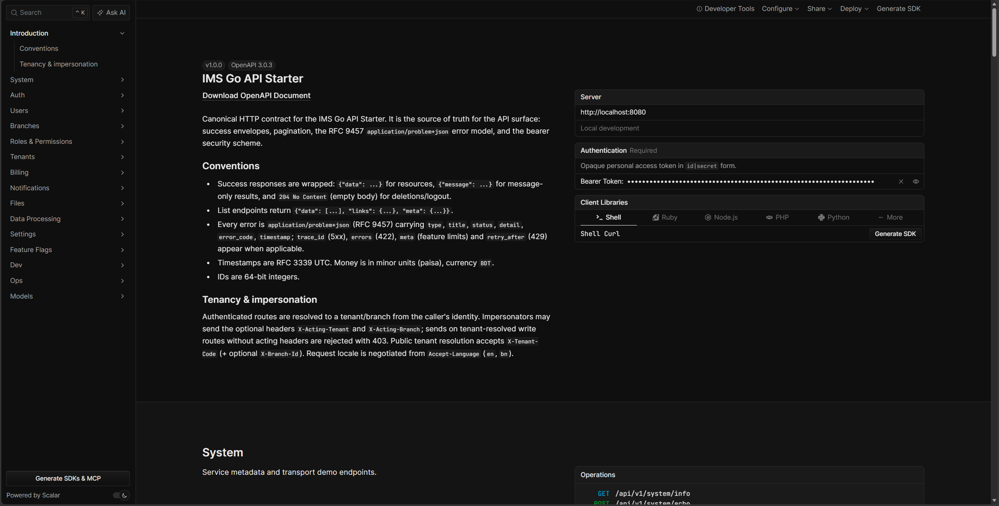

# IMS Go API Starter

[](https://github.com/Innovix-Matrix-Systems/ims-go-api-starter/actions/workflows/ci.yml)
[](https://github.com/Innovix-Matrix-Systems/ims-go-api-starter/actions/workflows/docs-deploy.yml)
[](https://goreportcard.com/report/github.com/Innovix-Matrix-Systems/ims-go-api-starter)

[](https://ims-go-api-starter.innovixmatrixsystem.com)
[](https://github.com/Innovix-Matrix-Systems/ims-go-api-starter/generate)
<br>


[](https://github.com/Innovix-Matrix-Systems/ims-go-api-starter/commits/main)

**Laravel's developer experience, Go's performance.** A multi-tenant API starter that ships as
**one CGO-free binary**: it serves the API, runs migrations, queue workers and the scheduler, and
embeds a Telescope-style **developer dashboard**. No containers required, Docker-ready when you want it.

**📖 Documentation: [ims-go-api-starter.innovixmatrixsystem.com](https://ims-go-api-starter.innovixmatrixsystem.com)**: quick start, tutorials,
a guide for every feature, the dashboard tour, operations runbooks and the design decisions.

| Developer dashboard (`/dev`) | API reference (`/docs`) |
| --- | --- |
|  |  |

## Why

- **Reads like Laravel.** Thin handlers (`h.Bind`, `h.Data`), permissions on routes
  (`r.With(h.can("product.create"))`), services, repositories, one config file per section — and
  `ims gen module` scaffolds the whole stack.
- **Multi-tenant and safe by default.** Tenant + branch isolation in SQL (fails closed), and a test
  that fails any route without a permission.
- **AI-ready.** An MCP server that Claude, ChatGPT, Cursor or OpenCode add as a connector, with its
  own OAuth 2.1 server; tools are your REST operations, under the same permissions.
- **Fast feedback.** Type-safe SQL (sqlc), integration tests in ~10 lines (`testkit`), hot reload,
  and AI-agent skills (`.agents/skills`) that know the codebase.

## Features

| Area | What you get | Guide |
| --- | --- | --- |
| Auth | Login with OTP, password reset, e-mail verification, sessions, personal access tokens, lockout | [Authentication](docs/guides/authentication.md) |
| Access | RBAC with a permission catalog, staff acting as a tenant or as a user (audited) | [Permissions](docs/guides/permissions.md) |
| Tenancy | Tenants and branches, isolation in SQL, public tenant routes | [Tenancy](docs/guides/tenancy.md) |
| AI agents | MCP server as a connector, OAuth 2.1 (PKCE, CIMD or registered clients), tools from OpenAPI `x-mcp` | [MCP](docs/guides/mcp.md) |
| Billing | Plans with feature limits, bKash, cash and bank payments | [Billing](docs/guides/billing.md) |
| Product | Settings, feature flags with percentage rollout, notifications, import/export | [Settings](docs/guides/settings.md) · [Flags](docs/guides/feature-flags.md) |
| Audit | Activity log, system audit log, request telemetry | [Activity log](docs/guides/activity-log.md) |
| Files | Local, S3, R2 or MinIO storage | [Files](docs/guides/files-and-storage.md) |
| Background | River queue, cron scheduler, backups | [Queue](docs/guides/queue-and-scheduler.md) · [Backups](docs/operations/backups.md) |
| Mail & i18n | Templated mail, English and Bangla out of the box | [Mail and i18n](docs/guides/mail-and-i18n.md) |
| API | RFC 9457 errors, validation, OpenAPI 3 with a contract check, `/docs` reference | [Errors](docs/guides/validation-and-errors.md) |
| Operations | Health probes, Prometheus metrics, structured logs, systemd or Docker deploy, rollback | [Observability](docs/guides/health-and-observability.md) · [Deploy](docs/operations/deploy.md) |
| Dashboard | Requests, logs, exceptions, queue, one-click commands, inspector, tenants, flags, files, audit — Ctrl+K | [Local development](docs/operations/local-development.md) |
| Tooling | `ims gen module`, `make rename`, sqlc, `testkit`, a CLI for every task | [Modules](docs/guides/modules.md) · [Testing](docs/guides/testing.md) |

## Quick start

<!-- rename:keep -->
Building a product on it? Press **[Use this template](https://github.com/Innovix-Matrix-Systems/ims-go-api-starter/generate)** on GitHub to get a repository of your own
(clean history, not a fork), clone it, and give it your names in one step:

```bash
make rename MODULE=github.com/acme/shop-api BINARY=shop TITLE="Acme Shop"   # DRY=1 to preview
git add -A && git commit -m "chore: rename the starter to shop-api"
```

That rewrites the Go module path, the binary and CLI name, the deploy names and paths, the
display title and the `IMS_` deploy variables, renames the systemd units, and regenerates code and
docs. Seeded e-mails and the credits are left alone.
<!-- rename:end -->

```bash
cp .env.example .env          # local configuration (git-ignored)
make tools                    # air + golangci-lint (once)
npm --prefix web/dev ci       # dashboard dependencies (once)
make db-up                    # Postgres via docker compose — or point DATABASE_DSN at your own
make migrate seed             # schema, then permissions, tenant, roles, admin + developer accounts
make dev                      # dashboard on :8080/dev + API with hot reload
```

Open **<http://localhost:8080/dev/>** and sign in as `superadmin@ims.com` or `developer@ims.com`
(password `123456`, set by `AUTH_DEFAULT_PASSWORD`); the API reference is at **/docs**. Run
`make queue` and `make schedule` in two more shells for background jobs and cron tasks.

Prefer containers? `docker compose up -d --build` runs Postgres, the API, the worker and the
scheduler from one image (see [Docker](docs/operations/docker.md)).

## Build a feature

```bash
go run ./cmd/app gen module --name=product --fields="name:string,price:decimal,is_active:bool"
```

You get the migration, queries, model, repository, service, request DTOs, handler, routes with
permissions, a unit test and the OpenAPI entry. Wire it in `internal/app`, add the permissions to
`internal/authz/catalog.go`, and test it like a Laravel feature test:

```go
app := testkit.New(t)
admin := app.User(t)
app.As(admin).Post("/api/v1/product", `{"name":"Pen","price":"10"}`).Status(t, http.StatusCreated)
```

## Commands

```bash
make help               # every target
make check              # gofmt + vet + lint + unit tests
make test-integration   # full suite (needs DATABASE_TEST_DSN)
make generate           # sqlc + OpenAPI code + generated regions
make build-all          # dashboard + bin/ims
```

The binary is the CLI too: `ims serve | queue:work | schedule | migrate | db:seed |
permission:sync | cache:clear | backup:run | gen module | ...` — and the common maintenance
commands also run from the dashboard.

## Learn more

**📖 Documentation: [ims-go-api-starter.innovixmatrixsystem.com](https://ims-go-api-starter.innovixmatrixsystem.com)**

The pages live in [`docs/`](docs/README.md) and are published as that site (Astro Starlight,
`website/`) with every release. Run `make docs` to read them locally.

| | |
| --- | --- |
| [Quick start](docs/getting-started/quick-start.mdx) · [How it works](docs/getting-started/how-it-works.mdx) | Run it, then understand the one rule every request follows |
| [Tutorial: your first module](docs/tutorial/first-module.mdx) | Build a products module step by step |
| [Tutorial: connect an AI agent](docs/tutorial/connect-an-ai-agent.mdx) | Claude Desktop, Claude Code or OpenCode against your local API |
| [Guides](docs/guides/modules.md) | Modules, handlers, database, tenancy, auth, testing, billing, queue, storage, … |
| [Operations](docs/operations/deploy.md) · [Docker](docs/operations/docker.md) | Local development, deploy (systemd or Docker), migrations, backups, rollback, releases |
| [Design decisions](docs/architecture/decisions.md) | What we chose, and why |
| [AGENTS.md](AGENTS.md) | Working guide for humans and AI agents |

Requires PostgreSQL 16+, Go 1.26.11+ and Node.js 20.19+ (dashboard). Every setting lives in `.env`
(documented in `.env.example`; `ims config:show` prints the effective values with secrets masked).

## Who's behind it

Built and maintained by **[Innovix Matrix System](https://innovixmatrixsystem.com)**, a software
studio in Dhaka, Bangladesh. We run our own products on it. More open-source starters:
[PocketBase BaaS](https://github.com/Innovix-Matrix-Systems/ims-pocketbase-baas-starter) ·
[NestJS API](https://github.com/Innovix-Matrix-Systems/ims-nest-api-starter) ·
[Laravel API](https://github.com/Innovix-Matrix-Systems/ims-laravel-api-starter) ·
[Laravel admin](https://github.com/Innovix-Matrix-Systems/ims-laravel-admin-starter).
Need a team to build on it? Write to **[hello@innovixmatrixsystem.com](mailto:hello@innovixmatrixsystem.com)**.
Questions about the starter: [support@innovixmatrixsystem.com](mailto:support@innovixmatrixsystem.com).
