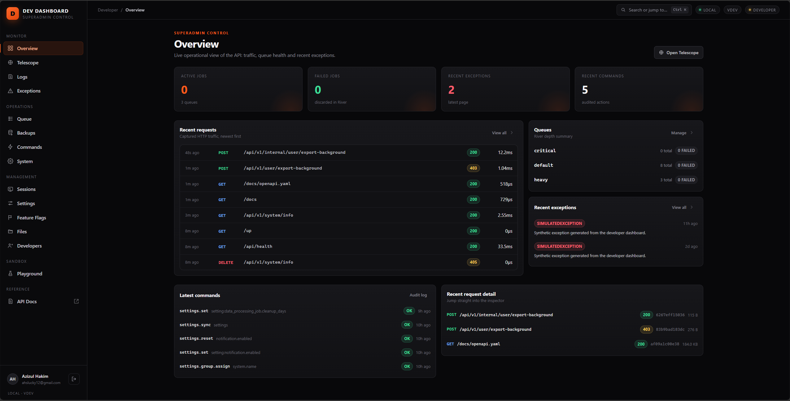

The developer dashboard is a React app **embedded in the binary** and served at `/dev`. Think of
Laravel Telescope, Horizon and a slice of Nova in one place, for the people who build and run the
API — not for your customers.

## Who can open it

| Setting / permission | Effect |
| --- | --- |
| `DEV_DASHBOARD_ENABLED` | on by default outside production; off in production unless you set it |
| `dev.view` | open the dashboard and read every panel |
| `dev.manage` | anything that changes something — every such action is **audited** |

The seeded **Developer** role (`developer@ims.com`) has both; the super admin can do everything.
Disabled deployments answer 404 at `/dev` before any authentication.

**Ctrl+K** (⌘K) opens the command palette from anywhere: jump to any panel, Inspector tab,
command or record.

## Monitor

| Panel | Shows |
| --- | --- |
| **Overview** | active and failed jobs, recent exceptions and commands, the latest requests, queue depth |
| **Telescope** | every captured request — headers, bodies (redacted), the SQL it ran, cache calls, jobs it enqueued, timing |
| **Logs** | warn-and-above log lines with full-text search, level and date filters |
| **Exceptions** | panics and 5xx with stack traces and the request that caused them |

## Operations

| Panel | Does |
| --- | --- |
| **Queue** | queues and jobs by state; pause/resume queues; retry, cancel or delete jobs. Shows the job envelope, never the payload |
| **Backups** | runs with size, checksum and destinations; create, clean, download (`dev.manage`) |
| **Commands** | runs the allowlisted maintenance commands in-process, with options, confirmation, background runs and output history |
| **Inspector** | **System** (health checks + runtime), **Routes** (every route with its middleware and permission), **Roles & permissions** (catalog vs database drift), **Config** (effective values, secrets masked), **Packages** (Go and npm dependencies) |
| **Audit log** | every dashboard action and sign-in (including failures — never the password) with IP and browser; filter by action, person, status and date |

## Management

| Panel | Does |
| --- | --- |
| **Tenants** | every tenant with its plan, usage against limits (`users 2 / 1` in red when over) and override counts; deep links to its settings and flags |
| **Sessions** | active tokens per user; revoke one, a user's, or all |
| **Settings** | every setting with its global value and per-tenant overrides; inline edit; drag keys between groups and reorder groups |
| **Feature Flags** | every flag per target (global, tenant, user) with a rollout slider |
| **Files** | every file across disks with thumbnails, previews (images, PDFs) and filters |
| **Developers** | who has dashboard access; grant or remove the Developer role |

## Sandbox

**Playground** (local only) enqueues sample jobs and generates sample logs and exceptions, so you
can see every panel populated without real traffic.

## How it is built

- The SPA lives in `web/dev` (React, TanStack Router and Query, cmdk for the palette) and is
  embedded with `go:embed`; release builds include it, so production needs no Node.
- Its JSON API is `/dev/api/*` (`internal/modules/dev`), documented in `api/openapi.yaml` like the
  rest of the API.
- Handlers call panel services (`services.go`, `inspector.go`, `commands.go`); every mutation is
  recorded in `dev_actions`, kept for `DEV_DASHBOARD_AUDIT_RETENTION_DAYS` (default 180).
- Telemetry comes from the collector described in
  [Health & observability](../guides/health-and-observability.md#telemetry-the-dashboard).

To add a panel, command or palette entry, see [Extending the dashboard](./extending.md).
