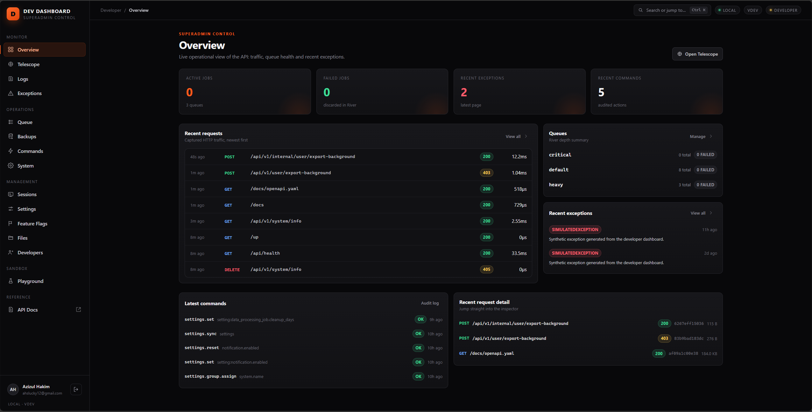

import { Steps, Tabs, TabItem, Aside } from '@astrojs/starlight/components'
import Terminal from '@components/Terminal.astro'

## Prerequisites

| Tool | Version | Why |
| --- | --- | --- |
| Go | 1.26.11 or newer | builds and runs the API |
| PostgreSQL | 16 or newer | the only database (local install, Docker, or a managed one) |
| Node.js | 20.19+ (22.23+ for the docs site) | builds the developer dashboard |
| make | any GNU make | shortcuts; every target is also a plain `go` command |

<Aside type="tip" title="No Docker required">
  `make db-up` starts Postgres with Docker Compose if you have it. If you already run Postgres
  (Homebrew, a Windows installer, a stack manager), just point `DATABASE_DSN` at it.
</Aside>

## Run it

<Steps>

1. **Make it your repository.** On GitHub, press **Use this template → Create a new repository**.
   You get your own repository with a clean history, not a fork that points back here. (Just
   trying it out? Clone this repository directly.)

2. **Clone and configure.** Copy the example environment; every value has a working local default.

   ```bash
   git clone <your-repository-url> ims-go-api && cd ims-go-api
   cp .env.example .env
   ```

3. **Install the tools once.** `air` (hot reload) and `golangci-lint`, then the dashboard's
   packages.

   ```bash
   make tools
   npm --prefix web/dev ci
   ```

4. **Start Postgres** — skip this if you already have one running.

   ```bash
   make db-up        # docker compose: creates ims_go_api and ims_go_api_test
   ```

5. **Create the schema and seed data.** Migrations first, then permissions, the default tenant,
   roles and two accounts.

   ```bash
   make migrate seed
   ```

6. **Run everything with hot reload.**

   ```bash
   make dev
   ```

</Steps>

<Terminal
  title="make dev"
  lines={[
    { cmd: 'make migrate seed' },
    { out: 'goose: successfully migrated database to version: 24', tone: 'dim' },
    { out: 'River schema: v8 (0 pending)', tone: 'dim' },
    { out: 'seeded permissions, tenant "Default", roles Admin + Developer', tone: 'ok' },
    { out: 'accounts: superadmin@ims.com, developer@ims.com', tone: 'ok' },
    { cmd: 'make dev' },
    { out: 'vite  → http://localhost:8080/dev/', tone: 'accent' },
    { out: 'air   → building ./cmd/app … running on :8081', tone: 'dim' },
    { out: 'http server listening addr=:8081 env=local', tone: 'ok' },
  ]}
/>

## Look around

Open **[localhost:8080/dev/](http://localhost:8080/dev/)** and sign in:

| Account | E-mail | Password | Can |
| --- | --- | --- | --- |
| Super Admin | `superadmin@ims.com` | `123456` | everything, every tenant |
| Developer | `developer@ims.com` | `123456` | the developer dashboard |

The password comes from `AUTH_DEFAULT_PASSWORD`. The API reference (Scalar, from
`api/openapi.yaml`) is at **[localhost:8080/docs](http://localhost:8080/docs)**.



Call the API from a terminal:

<Tabs>
<TabItem label="bash">

```bash
TOKEN=$(curl -s localhost:8080/api/v1/login -H 'Content-Type: application/json' \
  -d '{"email":"superadmin@ims.com","password":"123456","device":"cli"}' | jq -r .data.token)

curl -s localhost:8080/api/v1/branch -H "Authorization: Bearer $TOKEN" \
  -H "X-Acting-Tenant: 1" -H "X-Acting-Branch: 1" | jq
```

</TabItem>
<TabItem label="PowerShell">

```powershell
$login = Invoke-RestMethod http://localhost:8080/api/v1/login -Method Post `
  -ContentType 'application/json' -Body '{"email":"superadmin@ims.com","password":"123456","device":"cli"}'
$headers = @{ Authorization = "Bearer $($login.data.token)"; 'X-Acting-Tenant' = '1'; 'X-Acting-Branch' = '1' }
Invoke-RestMethod http://localhost:8080/api/v1/branch -Headers $headers
```

</TabItem>
</Tabs>

<Aside title="Why the X-Acting headers?">
  The super admin belongs to no tenant. To read or write a tenant's data it **impersonates** one
  with `X-Acting-Tenant` / `X-Acting-Branch`. A tenant user never sends them — their tenant comes
  from their account. See [Tenancy](../guides/tenancy.md).
</Aside>

## Background work

Queue jobs (mail, imports, backups) and scheduled tasks run in their own processes. Start them in
two more terminals when you need them:

```bash
make queue       # ims queue:work
make schedule    # ims schedule
```

## Next steps

- Understand the request path: [How it works](./how-it-works.mdx).
- Find your way around the folders: [Project tour](./project-tour.mdx).
- Build something: [Your first module](../tutorial/first-module.mdx).
- Something not working? [Local development & troubleshooting](../operations/local-development.md).
